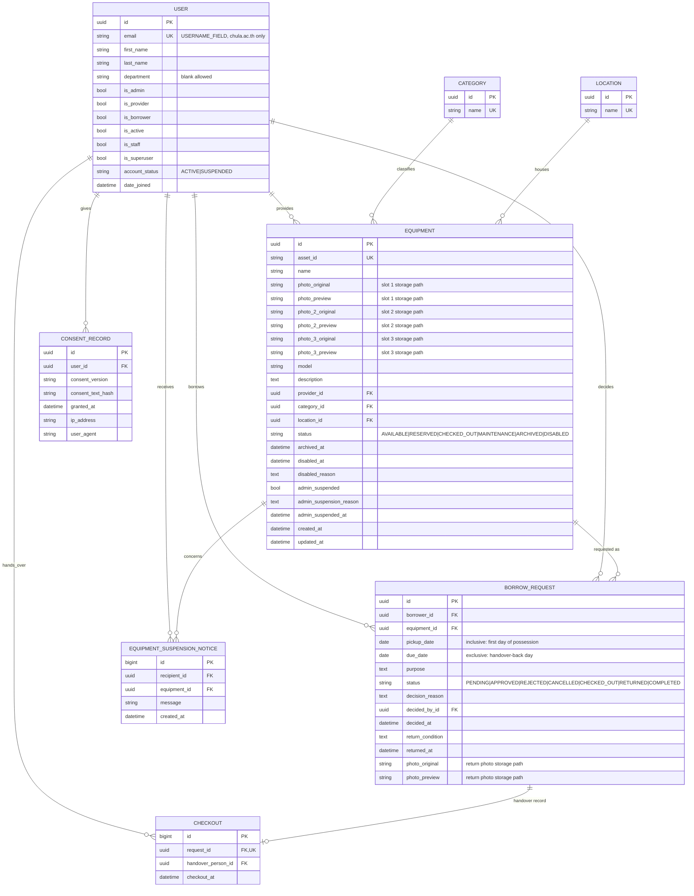

# UniWare ER Diagram

A checked-out borrow request represents an active loan; there is no separate Loan model. A checkout record stores the handover actor and time. Legacy requests may have no checkout record. `COMPLETED` is a legacy request status; new returns use `RETURNED`.

Photo fields contain private storage paths, not image data. Equipment supports three original/preview pairs; a return can have one pair. Empty strings indicate missing photos. `is_suspended` and `suspension_reason` are calculated properties, not database columns. The diagram omits Django's built-in authentication and session tables.
