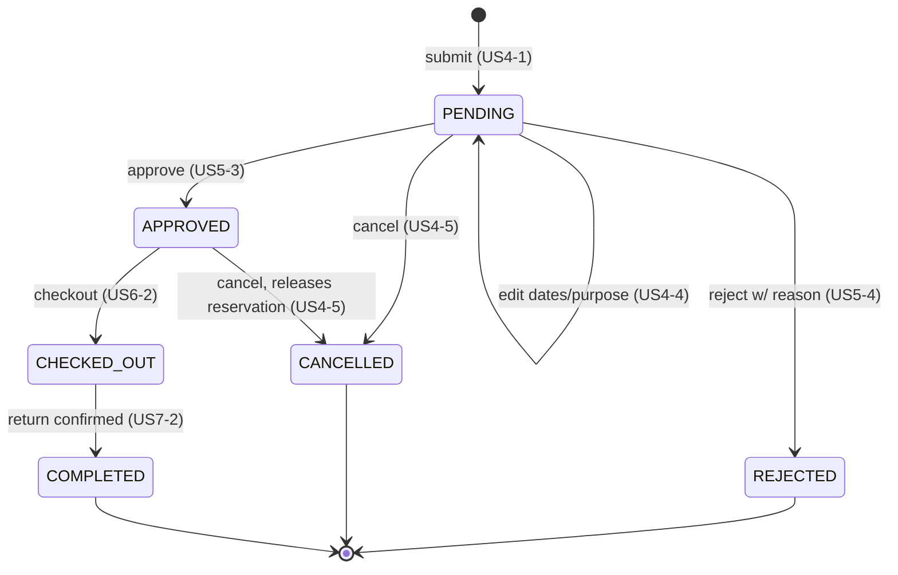
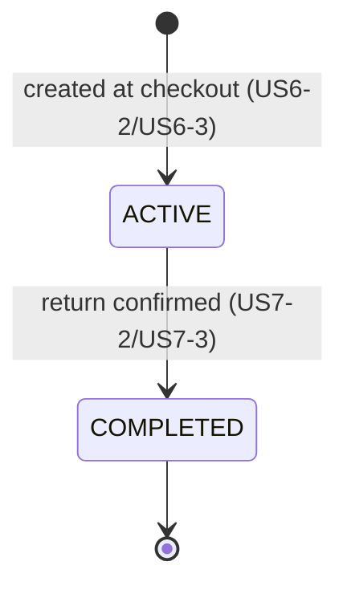

# UniWare — State Machines

## BorrowRequest

Provider decisions use `/api/provider/requests` and require an authenticated,
active provider. The inbox is scoped to equipment owned by that provider and
defaults to pending requests; `?status=ALL` includes all statuses. Detail and
decision routes are similarly owner-scoped, returning 404 for requests on
another provider's equipment.

`POST /api/provider/requests/{id}/approve` approves only pending requests. The
backend locks the request and equipment, verifies the equipment remains
available, and rechecks overlapping approved/checked-out periods before
recording the decision. A conflict returns 409 and leaves the request pending.
`POST /api/provider/requests/{id}/reject` requires a non-blank `reason` of at
most 2000 characters. Both decisions record `decided_by` and `decided_at`;
rejections also persist `decision_reason`. Repeated decisions return 409.

## Loan

